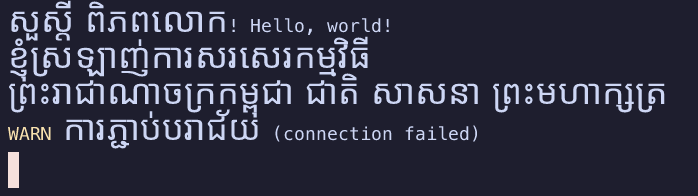

# Khmer Terminal Engine (KTE)

[](https://github.com/touchde/khmer-terminal-engine/actions/workflows/ci.yml)
[](LICENSE)

**Make Khmer Unicode work correctly everywhere people use terminals.**

```text
សួស្តី ពិភពលោក!
ការអភិវឌ្ឍកម្មវិធីជាភាសាខ្មែរ
```

> **Status: pre-alpha.** The [width spec](spec/kte-width-spec.md) (v0.2 draft) and the core libraries are implemented and tested. The standalone terminal [`kte-term`](apps/kte-term) runs your shell with correct Khmer rendering (MVP).



## The problem

Terminals lay text out on a grid of cells. Applications such as shells, editors and `tmux` count cells per codepoint with `wcwidth()`. The terminal keeps its own count. Khmer subscripts (coeng), pre-base vowels and split vowels make those two counts disagree. The result is gaps between letters, clipped subscripts, a drifting cursor and broken backspace.

You can't fix this inside one terminal. KTE's approach:

1. **A written standard.** The [KTE Width Spec](spec/kte-width-spec.md) defines how many cells a Khmer cluster occupies, using codepoints only.
2. **Reusable libraries** that implement the spec: Rust crates, a C ABI and WebAssembly.
3. **A standalone terminal** (`kte-term`) that serves as the reference implementation.
4. **Upstream contributions** to xterm.js, VS Code, WezTerm, Ghostty, Windows Terminal, VTE, Kitty, iTerm2 and to width libraries, shells and tmux.

See [docs/strategy.md](docs/strategy.md) for the full analysis and roadmap.

## Repository layout

| Path | Contents |
|------|----------|
| `spec/` | KTE Width Spec, the normative standard |
| `crates/kte-unicode` | Khmer classification, syllable segmentation, width rule |
| `crates/kte-shaper` | HarfBuzz shaping and cluster metrics |
| `crates/kte-cell` | Mapping shaped clusters onto terminal cells |
| `crates/kte-terminal` | VT/ANSI parser, grid, cursor, selection, wrapping |
| `crates/kte-core` | Stable facade API |
| `crates/kte-capi` | C ABI for native terminals |
| `apps/kte-term` | Standalone terminal emulator |
| `integrations/xtermjs` | xterm.js addon (TypeScript) |
| `include/kte.h` | C header for `kte-capi` |
| `tools/kte-measure` | Font measurement tool behind the spec |
| `tools/spec-ref` | Independent Python implementation of the spec; generates corpus expectations |
| `tests/corpus` | Khmer conformance corpus |
| `docs/` | Strategy, architecture, research, decisions (ADRs), upstream tracker |

## Usage

Rust:

```rust
use kte_core::{CellModel, Terminal, str_width};

assert_eq!(str_width("ភាសាខ្មែរ", CellModel::Wide), 11);

let mut term = Terminal::new(24, 80, CellModel::Wide);
term.feed("សួស្តី ពិភពលោក!".as_bytes());
assert_eq!(term.cursor(), (0, 21));
```

C (see [`include/kte.h`](include/kte.h) and [`examples/c/demo.c`](examples/c/demo.c)):

```c
size_t cells = kte_str_width((const uint8_t *)text, len, KTE_MODEL_WIDE);
```

WebAssembly: build `kte-capi` for `wasm32-unknown-unknown`; [`tests/wasm/smoke.mjs`](tests/wasm/smoke.mjs) shows how to call it from JavaScript.

## Building

Requires a stable Rust toolchain (MSRV 1.85).

```sh
cargo build
cargo test

# The terminal
cargo run -p kte-term --release

# C library and demo
cargo build -p kte-capi --release
cc examples/c/demo.c -Iinclude target/release/libkte_capi.a -o kte-demo && ./kte-demo

# WebAssembly
rustup target add wasm32-unknown-unknown
cargo build -p kte-capi --release --target wasm32-unknown-unknown
node tests/wasm/smoke.mjs

# Re-run the font measurements
cargo run -p kte-measure --release -- /path/to/fonts
```

## Roadmap

| Phase | Deliverable | Status |
|-------|-------------|--------|
| 0 | KTE Width Spec v0 + conformance corpus | 🟡 v0.1 draft; needs native review, more fonts and corpus |
| 1 | Core crates (Rust, C ABI, WASM) | ✅ done |
| 2 | `kte-term` MVP (macOS first, then Windows and Linux) | 🟡 MVP works; scrollback view, font fallback and packaging next |
| 3 | xterm.js addon → VS Code | ⬜ |
| 4 | Native terminals (WezTerm → Ghostty → Windows Terminal → others) | ⬜ |
| 5 | Width libraries, shells, tmux | ⬜ |

Progress on each upstream project is tracked in [docs/upstream](docs/upstream/README.md).

## Contributing

Contributions are welcome, especially from native Khmer readers who can judge rendering quality. Read [CONTRIBUTING.md](CONTRIBUTING.md) first. This project follows the [Code of Conduct](CODE_OF_CONDUCT.md).

## License

[MIT](LICENSE)
