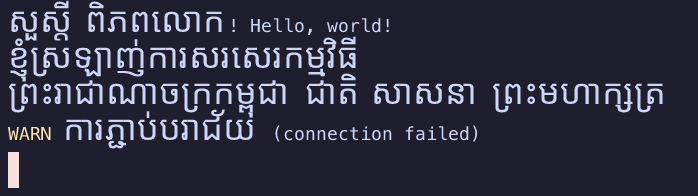
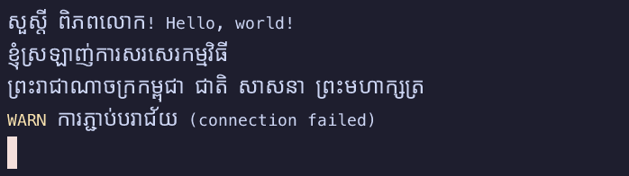
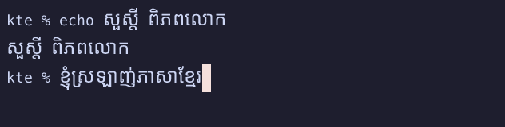

# kte-term

The standalone KTE terminal: a terminal emulator with first-class Khmer support, and the reference implementation of the [KTE Width Spec](../../spec/kte-width-spec.md).

**Status: MVP (Phase 2).** Runs your shell, renders Khmer correctly, and supports typing, copy and paste. Developed and tested on macOS; builds and renders on Linux and Windows in CI.



## Run

```sh
cargo run -p kte-term --release

# macOS: build a double-clickable app
apps/kte-term/macos/make-app.sh
open "target/release/KTE Terminal.app"
```

## Cell models

How many cells each Khmer syllable takes. See [ADR 0005](../../docs/adr/0005-kte-term-architecture.md) and [Research 0003](../../docs/research/0003-shell-compatibility.md) for the reasoning.

| `--model` | Use it when | Look |
|-----------|-------------|------|
| `legacy` **(default)** | Working in today's shells and editors (zsh, bash, vim). Matches the system `wcwidth()`, so line editing works. | Natural Khmer; text after a Khmer word may shift right (see below). |
| `wide` | Reading Khmer output, or with apps that follow the KTE spec. | Natural Khmer on an exact grid. Line editing in today's shells breaks. |
| `compact` | Dense output. | One cell per consonant. |

Legacy, macOS (Apple `wcwidth()`):


Legacy, Linux (glibc `wcwidth()`):



Typing Khmer into zsh (Legacy model):



### zsh users: enable `COMBINING_CHARS`

zsh shows Khmer vowels and COENG as `<17d2>` unless this option is on. Add it to `~/.zshrc`:

```zsh
setopt COMBINING_CHARS
```

bash needs no setting.

## Options

```
--model <MODEL>       legacy (default), wide, compact, legacy-glibc, legacy-apple
--font-size <PX>      Latin font size in pixels [default: 15]
--line-height <X>     Row height as a multiple of the font's line height [default: 1.7]
--khmer-fill <X>      Khmer size in cells per consonant, 0.5-2.0 [default: 1.4 legacy/compact, 1.0 wide]
--rows <N>, --cols <N>
--snapshot <FILE>     Render to a PNG instead of opening a window
--text <TEXT>         Text for --snapshot
--command <CMD>       With --snapshot: run CMD in a real pty
--type <TEXT>         With --snapshot: type TEXT into it (\n = Enter)
```

Fonts are found automatically: Menlo / DejaVu Sans Mono / Cascadia Mono for Latin; Noto Sans Khmer, Khmer OS, Khmer UI, Khmer Sangam MN or Leelawadee UI for Khmer, in that order of preference. Override them with `KTE_FONT` and `KTE_KHMER_FONT`.

## Keys

| Keys | Action |
|------|--------|
| Cmd+C / Cmd+V (macOS), Ctrl+Shift+C / Ctrl+Shift+V | Copy selection / paste (bracketed paste when the app asks for it) |
| Mouse drag | Select (snaps to whole syllables; copies the exact original text) |

Arrow keys, Home/End, Page Up/Down, Delete, F1–F12 and Ctrl/Alt combinations send xterm sequences, including application cursor mode for vim and less.

## How it works

- **Terminal model:** [`kte-terminal`](../../crates/kte-terminal): VT parsing, grid, cursor, selection.
- **Rendering:** CPU rasterization with `tiny-skia`, shown with `softbuffer`. Each frame draws all backgrounds first, then all glyphs, so Khmer subscripts and above-vowels that extend into the next row are never covered or clipped.
- **Khmer shaping:** each Khmer word (consecutive Khmer cells of one color) is shaped once with HarfBuzz ([`harfrust`](https://github.com/harfbuzz/harfrust)) at one font size. Cells that `wcwidth()` split apart are joined again first.
- **Grid in logic, flow in pixels:** the terminal grid stays exactly what the application expects, but a Khmer word is drawn at its natural width. If it needs more room than its cells, the text and cursor after it on that line move right, and cells the application never wrote give the room back. Only if a line would run past the window is its Khmer compressed, by one factor for the whole line. Fitting each syllable into its own cells instead made letters alternate between big and small.
- **Shell:** [`portable-pty`](https://crates.io/crates/portable-pty) runs your login shell (ConPTY on Windows), with `TERM=xterm-256color` and a UTF-8 locale.

## Known limitations

- No scrollback viewing yet (the scrollback is kept, but the view does not scroll).
- No font fallback beyond the Latin and Khmer fonts (e.g. CJK and emoji show as missing glyphs).
- No bold/italic font faces (bold brightens the color instead).
- No mouse reporting to applications.
- Resizing does not re-wrap existing lines.
- In Legacy mode, columns to the right of Khmer text (tables, vim status lines) can shift by the extra width the Khmer words need.
- Windows: the Legacy model uses glibc rules; console applications' widths are not yet measured.
